# Motion feels

**Website motion in everyday words.** A skill for Claude (and other AI agents that read `SKILL.md`) that lets you describe animation the way you'd describe it to a friend, and get the right speed and easing curve, without knowing what an easing curve is.

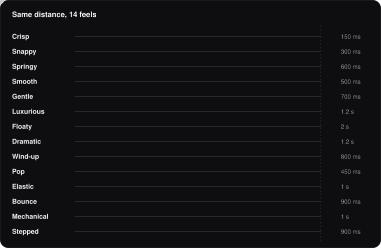

> "Make the project photos come in slow and expensive."
> "The menu feels cheap and jumpy."
> "Can it be bouncier? Like, fun bouncy, not cartoon bouncy."

Words like these fit dozens of curves, so an AI usually guesses, and you end up going back and forth with "too fast", "less bouncy". Motion feels gives you and the AI one shared set of names, each tied to exact values, so the first version lands close and every change is a small, precise step.

## What it does

- **Understands everyday words.** "Premium", "calm", "like a feather", "lands hard", "feels cheap" each map to a named feel or a precise change.
- **Asks in plain words when you're unclear.** "Bounce like a ball landing, or overshoot a little and settle?" Never "which easing do you want?"
- **Turns feedback into exact changes.** "Too fast" makes it 1.5× slower. "Too much" takes the overshoot down one step. "Feels off" gets a question about the speed, the start, the stop or the bounce, instead of a guess.
- **Knows when not to animate.** Things you see on every page stay quick; scroll reveals play once; loaders run on the first visit only.
- **Picks a motion palette for your brand.** Two or three feels for the whole site, so every section moves the same way.
- **Builds it properly.** Smooth on phones, respects reduced-motion settings, no stuck hover effects on touch screens, content never hidden if a script fails.
- **Reviews existing motion** with a 10-point checklist, in plain words, with exact fixes for developers.

## The 14 feels

Each feel is a speed plus a curve. The dot on the left follows the curve; the ball shows how it actually moves, at real speed.

**Quick and responsive**

<p>
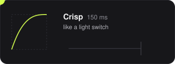
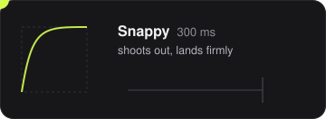
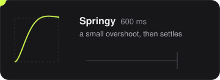
</p>

**Smooth and calm**

<p>
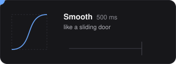
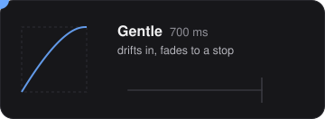
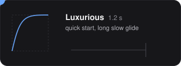
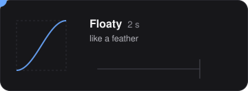
</p>

**Big moments**

<p>
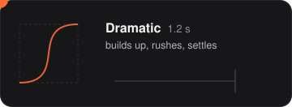
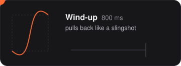
</p>

**Playful and physical**

<p>
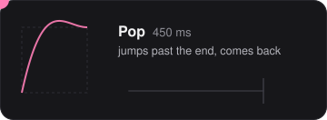
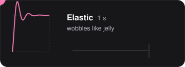
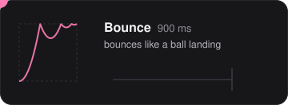
</p>

**Mechanical**

<p>

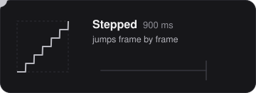
</p>

Every feel comes with exact values for CSS, GSAP and springs. See [SKILL.md](skills/motion-feels/SKILL.md).

## You say, you get

| You say | You get |
|---|---|
| "premium", "elegant", "like a magazine" | **Luxurious**: quick start, a long slow glide to rest |
| "calm", "cozy", "not flashy" | **Gentle**: drifts in and fades to a stop |
| "punchy", "confident", "lands hard" | **Snappy**: shoots out and lands firmly |
| "like a phone app", "natural" | **Springy**: a small overshoot, then settles |
| "dreamy", "like a feather" | **Floaty**: slow and even, no clear start or stop |
| "like a movie", "a wow moment" | **Dramatic**: builds up, rushes, settles |
| "bouncy", "fun" | a quick question: ball landing (**Bounce**) or overshoot and settle (**Pop**)? |
| "too fast" / "too slow" | the same feel, 1.5× slower / faster |
| "feels cheap" | less movement and less overshoot |
| "make it pop", "make it look good" | three feels that fit your brand, in plain words |

## A conversation

> **You:** make the case study cards come in when you scroll, something premium
>
> **Claude:** The cards glide up and settle slowly as you scroll to them, one after another, and only the first time (feel: **Luxurious**). *For developers: 1.2 s, `cubic-bezier(0.22, 1, 0.36, 1)`, stagger 80 ms.*
>
> **You:** a bit too slow
>
> **Claude:** Faster: 1.2 s → 0.8 s. Same glide, just quicker.

## See them live

Open [`skills/motion-feels/assets/feels-demo.html`](skills/motion-feels/assets/feels-demo.html) in any browser: all 14 feels side by side, each curve plotted, with a slow-motion switch. [`effects-demo.html`](skills/motion-feels/assets/effects-demo.html) next to it shows 14 effects (mask reveals, parallax, marquees, magnetic buttons and more).

## Install

**Claude Code, as a plugin**

```
/plugin marketplace add nusakutnjak/motion-feels
/plugin install motion-feels@motion-feels
```

**Claude Code, as a plain skill:** copy the `skills/motion-feels` folder into `~/.claude/skills/`.

**Claude apps (claude.ai, desktop):** zip the `skills/motion-feels` folder and upload it as a skill in Settings.

**Other agents that read `SKILL.md`:** copy `skills/motion-feels` into the agent's skills folder.

Then just describe motion the way you normally would. The skill switches on whenever you build, change or review animation on a website.

## What's inside

```
skills/motion-feels/
├── SKILL.md               the feels, everyday words, feedback, rules, review checklist
├── references/feels.md    every dial's values and 14 effect recipes
└── assets/
    ├── feels-demo.html    live demo of the 14 feels
    └── effects-demo.html  live demo of the effects
previews/                  the animated previews in this README
evals/                     test cases (run with `claude plugin eval .`)
```

## Credits

- When to animate, interface speeds, build rules and the review checklist are adapted for websites from [Emil Kowalski's skills](https://github.com/emilkowalski/skills) (MIT).
- Curves: the standard easing families (Robert Penner's, as used by GSAP and easings.net), a damped spring, and GSAP's elastic and bounce formulas.

## License

[MIT](LICENSE)
